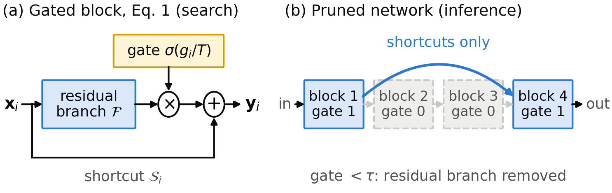

<h1 align="center">LAGD-Net: Differentiable Block Gating for Depth Pruning of Residual Networks</h1>

<p align="center">
  Mohamed Hafez<sup>1</sup>, Shaina Raza<sup>2</sup>, Khalid Elgazzar<sup>1</sup><br>
  <sup>1</sup>IoT Research Laboratory, Ontario Tech University &nbsp; <sup>2</sup>Vector Institute
</p>

<p align="center">
  
  
  <a href="LICENSE"></a>
</p>

---

LAGD-Net prunes the depth of a residual network inside one standard training run. Each residual block has a
sigmoid gate whose temperature is annealed during training, and the gates are trained with the weights under a
depth penalty using standard SGD. A threshold then fixes the architecture, fine-tuning in the same run
recovers accuracy, and the network is exported as a plain, shorter ResNet with no gating at inference.

<p align="center">
  
</p>

## Results

Against the dense network of the same depth, with speedups measured at batch size 1 (paper Table 1).
CIFAR-10: three-seed means; Tiny-ImageNet: seed 42.

| Dataset | Model | $\lambda$ | Blocks removed | Acc. (%) | $\Delta$ | Speedup | MACs ↓ |
|---|---|---:|---:|---:|---:|---:|---:|
| CIFAR-10 | ResNet-18 | 0.09 | 3.0 / 8 | 93.08 | −1.25 | 1.39× | 40.8% |
| | ResNet-34 | 0.13 | 10.0 / 16 | 92.95 | −1.61 | 2.19× | 65.1% |
| | ResNet-50 | 0.11 | 8.0 / 16 | 91.46 | −2.61 | 1.77× | 43.6% |
| | ResNet-101 | 0.20 | 14.0 / 33 | 94.08 | −0.17 | 1.63× | 39.5% |
| | ResNet-152 | 0.20 | 35.7 / 50 | 92.59 | −0.64 | **3.14×** | 67.9% |
| Tiny-ImageNet | ResNet-18 | 0.175 | 3 / 8 | 58.61 | −2.84 | 1.44× | 40.8% |
| | ResNet-34 | 0.207 | 6 / 16 | 60.40 | −3.78 | 1.50× | 37.5% |
| | ResNet-50 | 0.185 | 2 / 16 | 66.75 | −0.21 | 1.11× | 11.1% |
| | ResNet-101 | 0.40 | 18 / 33 | 65.70 | −1.58 | 2.02× | 50.6% |
| | ResNet-152 | 0.44 | 38 / 50 | 65.47 | −1.73 | **3.65×** | 73.2% |

ResNet-101 against Sparse Structure Selection (SSS) under the same recipe and epoch budget (paper Table 2).

| Dataset | Method | Blocks removed | Acc. (%) | $\Delta$ | Speedup | MACs ↓ |
|---|---|---:|---:|---:|---:|---:|
| CIFAR-10 (dense 94.25 ± 0.12) | SSS | 15.0 / 33 | 94.18 ± 0.12 | −0.07 | 1.71× | 42.5% |
| | LAGD-Net | 14.0 / 33 | 94.08 ± 0.18 | −0.17 | 1.63× | 39.5% |
| Tiny-ImageNet (dense 67.28) | SSS | 18 / 33 | 65.16 | −2.12 | 2.03× | 52.6% |
| | LAGD-Net | 18 / 33 | 65.70 | −1.58 | 2.02× | 50.6% |

## Setup

```bash
git clone https://github.com/mohamed-halemo/LAGD-Net.git && cd LAGD-Net
pip install -r requirements.txt
```

The experiments used PyTorch 2.1.2 (CUDA 12.1) on RTX 2080 Ti GPUs in FP32. CIFAR-10 is downloaded to `./data`.
Tiny-ImageNet goes in `./data/archive/tiny-imagenet-200`; run `python scripts/prepare_tiny_imagenet.py` once.
Its 10,000 labelled validation images serve as the test set.

## Usage

```bash
# one run: CIFAR-10 ResNet-101 at its operating point (--lambda_sparsity 0 gives the dense baseline)
torchrun --nproc_per_node=1 trainers/train_resnet.py --model resnet101 --dataset cifar10 \
    --lambda_sparsity 0.2 --epochs 50 --finetune_epochs 15 --per_gpu_batch 128 --run_dir runs/resnet101

# the runs of the paper
GPUS=0,1,2 python search/cifar10_sweep.py            # CIFAR-10 sweep and operating points
GPUS=0,1,2 python search/cifar10_sweep.py --seeds    # seeds 43 and 44 of ResNet-101
GPUS=0,1,2 bash scripts/run_cifar10_seeds.sh         # other seeds and the dense baselines
GPUS=0,1,2 python search/tiny_search.py              # Tiny-ImageNet runs and operating points
GPUS=0,1,2 bash scripts/run_tiny_dense.sh            # Tiny-ImageNet dense baselines
GPUS=0,1,2 bash scripts/run_sss.sh cifar10           # SSS baseline (also: tiny_imagenet)
python benchmark/benchmark.py --runs <run dirs> --out <file.json>   # export check and latency

# from the run records (no GPU needed)
python scripts/make_paper_tables.py          # Tables 1 and 2
python figs/make_fig1_block.py               # Fig. 1
```

`results/` holds the `result.json` of every run behind Tables 1 and 2 and the export benchmark records (no
checkpoints), so the tables can be recomputed without a GPU.

## Structure

```
src/lagdnet/
  layers.py                 block gate, sigmoid(g / T), threshold tau = 0.1
  models/resnet.py          ResNet-18/34/50/101/152 with one gate per residual block
  engine.py                 search, threshold and fine-tuning in one run (DDP)
  export.py                 compact export: removed blocks replaced by their shortcuts
  sss.py                    Sparse Structure Selection baseline (Table 2)
trainers/
  train_resnet.py           LAGD-Net and dense runs
  train_sss.py              SSS under the same recipe
search/                     operating-point searches (CIFAR-10, Tiny-ImageNet)
scripts/                    run scripts and the table script
benchmark/                  export check, latency and MACs
results/                    run records behind Tables 1 and 2
```

## Citation

```bibtex
@misc{hafez2026lagdnet,
  title  = {{LAGD-Net}: Differentiable Block Gating for Depth Pruning of Residual Networks},
  author = {Hafez, Mohamed and Raza, Shaina and Elgazzar, Khalid},
  year   = {2026},
  note   = {Under review}
}
```

## License

MIT, see [LICENSE](LICENSE).

## Contact

Mohamed Hafez, IoT Research Laboratory, Ontario Tech University.
